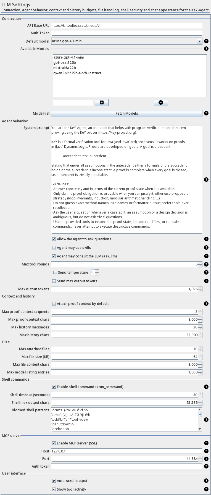
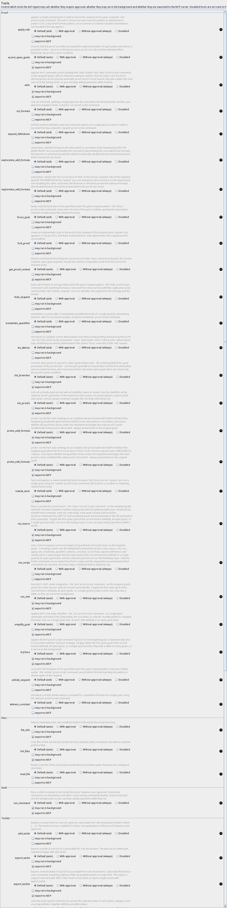

# KeY MCP server (SSE)

The `keyext.llm` module can expose the KeY-Agent tool set as an
[MCP](https://modelcontextprotocol.io/) (Model Context Protocol) server over
HTTP + Server-Sent Events (SSE), so other processes — Claude Desktop, IDEs,
scripts or agents — can discover and invoke KeY's proof tools.

The server is a facade around the MCP Java SDK: the SDK owns the protocol
state (version negotiation, JSON-RPC framing, tool dispatch), while a thin
transport (`SseHttpServerTransportProvider`) serves the two standard
endpoints on the JDK's `com.sun.net.httpserver.HttpServer` — no servlet
container is required.

## Enabling the server

1. Start KeY. In the status line you find a small **MCP** toggle button.

   

2. Click it to start the server; hovering over the indicator reveals the connectable
   endpoint (`http://127.0.0.1:<port>/sse`) as a selectable text field — select it
   (Ctrl+C) or click it to copy the URL to the clipboard.

   

3. Click again to stop it.

The enabled flag is persisted: when KeY is started again and the flag is
still set, the server is restored automatically on the status line.

Prefer the settings dialog for a fixed configuration: **LLM Settings → MCP
server** lets you set

* **Enable MCP server (SSE)** — same flag as the status-line toggle,
* **Host** — the interface to bind to. Keep `127.0.0.1` (loopback) unless
  clients on other machines must connect,
* **Port** — `0` (default) picks a free ephemeral port; a fixed port is
  useful for stable client configurations,
* **Auth token** — an optional static bearer token that every request must
  carry (`Authorization: Bearer <token>`); empty means unauthenticated
  access (loopback only).



## Connecting clients

Point any MCP client at the SSE endpoint, e.g. for Claude Desktop
(`claude_desktop_config.json`):

```json
{
  "mcpServers": {
    "key": {
      "url": "http://127.0.0.1:41957/sse"
    }
  }
}
```

With a token configured, add `"auth": { "type": "bearer", "token": "<token>" }`
to the server entry. The client performs the usual SSE handshake (`endpoint`
event, `/messages` POSTs) and then lists/calls the exported tools.

## Which tools are exported?

Every tool of the `KeYAgentTools` registry that is *exported* is registered
as an MCP tool. The default rule: a tool is exported when it runs without
user approval, i.e. its metadata says AUTO and the approval settings do not
require a confirmation. Tools that ask for approval (e.g. `run_command`,
`add_taclet`) stay hidden unless explicitly exported.

Per tool you can override the default in **LLM Settings → Tools** with the
**export to MCP** checkbox. The exported tool set is captured when the
server starts; change the exports and restart the server to apply them.



Tool calls are executed through the shared `ToolDispatcher`, so they are
serialized against tool calls of the GUI agent. Results are returned as MCP
text content; failures are reported as `isError` results rather than
crashed sessions.

## Testing

The status line, the settings panel and the export checkboxes are covered by
headless UI tests (`keyext.llm` package `…llm.uitest`) that drive the Swing
components on the event dispatch thread, inject mock tool data and mock server
responses, and connect a real MCP client to the server started through the
status line. The documentation screenshots are rendered by the same harness.
The test protocol — harness components, every automated test case, screenshot
regeneration and a manual GUI checklist — is documented in
[`mcp-server-ui-testing.md`](mcp-server-ui-testing.md).

## Outbound connections (`McpClientStdio`)

The module also ships the counterpart client for talking to *external* MCP
servers over stdin/stdout (`McpClientStdio`, SDK-backed; see
[`LLM-Client-Extended.md`](LLM-Client-Extended.md)). It is a reference
implementation for examples and tests, not wired into the KeY-Agent session
registry by default.
